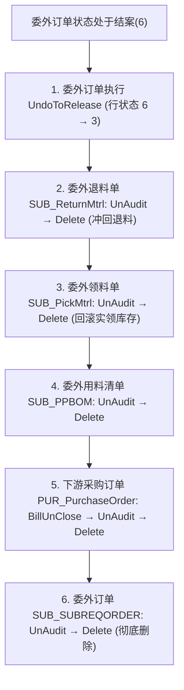

# 委外订单全链路逆向删除与死锁解除 (SUB_SUBREQORDER)

> 2026-11-04 实测验证（SUB00001104 全链路逆向删除）

## 核心死锁与突破点

当委外订单已发生领料、退料，或已被自动/手工结案，且已生成下游采购订单（加工费结算）时，直接删除会被多重校验拦截：

1. **退料单反审核死锁**：委外退料单 `SUB_ReturnMtrl` 反审核时校验“对应委外订单分录业务状态必须为下达或完工”，若退料后委外订单分录已为结案（`FStatus = 6`），反审核退料单直接被拒。
   - **解法**：先对委外订单 `SUB_SUBREQORDER` 调用 `UndoToRelease` 操作（反执行至下达），将行状态从 `6` 恢复为 `3`（下达）。
2. **委外订单反审核下游锁**：委外订单审核时会自动下推生成下游采购订单 `PUR_PurchaseOrder`（加工费结算），若该采购订单处于已审核或已关闭（`FCloseStatus = B`）状态，委外订单反审核时报“已经存在关联的下游单据采购订单”。
   - **解法**：先对下游采购订单依次执行 `BillUnClose`（反关闭）→ `unAuditBill`（反审核）→ `deleteBill`（删除）。

---

## 标准逆向删除时序

---

## 关键 WebAPI 操作定义

| 业务对象 / FormId | 操作名称 | WebAPI 调用形式 | 关键参数 |
| :--- | :--- | :--- | :--- |
| **委外订单** (`SUB_SUBREQORDER`) | 反执行至下达 | `api.executeOperation('SUB_SUBREQORDER', 'UndoToRelease', payload)` | `Ids`, `EntryIds` |
| **委外退料单** (`SUB_ReturnMtrl`) | 反审核 / 删除 | `api.unAuditBill('SUB_ReturnMtrl', fid)` / `api.deleteBill` | 单据 `FID` |
| **委外领料单** (`SUB_PickMtrl`) | 反审核 / 删除 | `api.unAuditBill('SUB_PickMtrl', fid)` / `api.deleteBill` | 单据 `FID` |
| **委外用料清单** (`SUB_PPBOM`) | 反审核 / 删除 | `api.unAuditBill('SUB_PPBOM', fid)` / `api.deleteBill` | 单据 `FID` |
| **采购订单** (`PUR_PurchaseOrder`)| 反关闭 / 反审核 / 删除 | `api.executeOperation('PUR_PurchaseOrder', 'BillUnClose', { Ids })` → `unAuditBill` → `deleteBill` | 单据 `FID` |
| **委外订单** (`SUB_SUBREQORDER`) | 反审核 / 删除 | `api.unAuditBill('SUB_SUBREQORDER', fid)` → `api.deleteBill` | 单据 `FID` |
